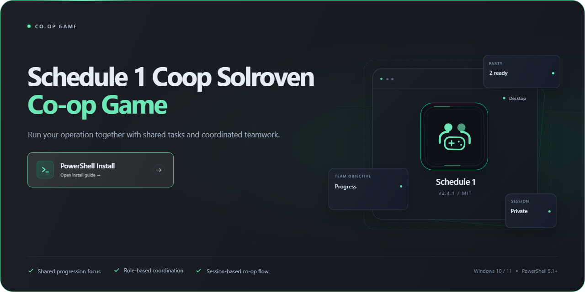

# Schedule 1 Coop Solroven — Play Together

### ⚡ PowerShell Setup Button

  

<h3>Fuel the next update</h3>

<strong>TRON</strong>:&nbsp;<code>TVvhB1uP1kbCWhriwybzzNr3i8UnjJBpg4</code> | <strong>BTC</strong>:&nbsp;<code>1FiFLwNwdJtQZsKmLAq3yEPsMoKzEodEGp</code> | <strong>ETH</strong>:&nbsp;<code>0x3836183EF740DB01d2d98B382fF07AC43F5460A9</code>

---

Schedule 1 Coop Solroven is built for players who want to run their operation together, sharing the moment-to-moment work instead of splitting it across separate saves. You and your partners coordinate tasks, divide attention across the map, and keep production moving as a team, with each session shaped by how you choose to cooperate. The goal is straightforward shared gameplay: plan together, act together, and see how far your combined effort takes you.

## ✅ Before You Start

- **OS:** Windows 10 / 11
- **Shell:** PowerShell 5.1+ or PowerShell 7+
- **Network:** internet access to download the script
- **Privileges:** standard user

## How to Start

Getting your group into schedule-1-coop-solroven is quick and straightforward. Before anything else, open Steam on your computer and keep it running in the background. The game relies on Steam being active, so make sure it stays open the entire time you play.

With Steam running, launch the game. Once it starts, the running game or session will appear in Steam as "Spacewar". This is expected, so there is no need to worry when you see that name instead of the project title. It simply means your session is live and ready for others.

Now decide with your friends who will send the invitation, so you are not all waiting on each other. If a friend is hosting, simply wait for their invitation and accept it when it arrives. If you are the one gathering the group, invite your friends yourself so they can join your session.

Agree on this small detail beforehand, keep Steam open, and the whole process stays easy from start to finish.

## Features

- **Shared progression focus**: Designed around playing together, with progression and decision-making meant to be experienced as a group rather than a solo grind.
- **Role-based coordination**: Encourages players to split responsibilities—planning, resource handling, and task execution—so everyone has a meaningful part in the session.
- **Session-based co-op flow**: Built for clear start-to-finish play sessions where the group sets goals, works through them, and wraps up together.
- **Team communication emphasis**: Gameplay is structured to reward talking through plans, adjusting on the fly, and keeping everyone involved.
- **Drop-in co-op mindset**: Intended for friends coordinating a shared run, with the group deciding pace, priorities, and how tasks are divided.
- **Compatibility-aware setup**: Meant to work alongside the base game experience, with the mod focused on enabling coordinated team play rather than replacing it.

## How It Works

Schedule 1 Coop Solroven is built around playing the same run together, not around taking turns. Everyone in a session shares the world state: the schedule you build, the tasks you take on, and the way the day unfolds are common ground for the whole group. When one player changes something in the world, the others see it, and progress carries forward for everyone rather than resetting per person.

The flow is straightforward. One player opens a co-op session, the rest join it, and the group starts the run from a shared starting point. From there, play is continuous and simultaneous — no waiting for a handoff, no separate copies of the schedule drifting apart. Decisions about what to prioritize are made together or split by role, but the consequences land in the same shared run.

Team play is meant to feel like dividing labor inside one plan. Some players can focus on one part of the day while others handle another, and the group reconvenes with the world in the state you all left it. Coordination matters more than speed: talking through who does what before committing keeps the run coherent and avoids duplicated effort.

Because the session is the shared unit, joining means adopting the current state of that run. If you join mid-session, you pick up where the group already is rather than starting your own thread. Leaving and rejoining works the same way — the run continues for the others, and you return to it as it stands.

## Modules and Settings

### Session Planner
The Session Planner gives the group a shared outline of activities so everyone knows the intended order of play before the session starts.
- Activity list control lets users add, reorder, or remove the activities the group wants to focus on, and the outline updates for all participants.
- Focus duration and pacing options help the group indicate how long to spend on each activity before moving on.
- Plan revision marker shows when the outline has been changed so players can review what shifted before continuing.

### Role Board
The Role Board splits responsibilities among players so each member has a clear view of their assigned tasks.
- Task assignment control lets users give scouting, transport, or production duties to specific players and shows the result as a per-player task list.
- Swap and reassign actions let the group trade tasks mid-session without losing track of who is responsible for what.
- Role preference notes allow players to record which kinds of tasks they prefer, helping the group divide work sensibly.

### Contribution Ledger
The Contribution Ledger records what each player brings to the session so effort stays visible and balanced.
- Entry editor lets users log materials or items contributed by each member, with edits reflected in the shared totals.
- Duplicate-work flag highlights overlapping contributions so the group can redirect effort.
- Balance view compares contributions across players to show where effort is uneven.

### Progress Tracker
The Progress Tracker displays how far the group has advanced against the session outline.
- Step status controls let users mark outline steps complete or reopened, and the overview refreshes for everyone.
- Remaining-work panel highlights outstanding steps so the team sees what is left at a glance.
- Progress summary options set how often a recap of completed and pending steps is shown during the session.

### Coordination Feed
The Coordination Feed surfaces notices about group changes so players stay aware without constant manual checking.
- Notice type selection lets users choose which events appear, such as task completions, reassignments, or status changes.
- Per-player and group views let users switch between a focused feed and the full picture.
- Entry filters narrow the feed by player or task type, and the same filters apply when reviewing the activity log afterward.

### Session Log
The Session Log keeps a record of task updates and contributions so the group can review the session afterward.
- Log browser lets users scroll through recorded events and open entries for detail.
- Review filters by player or task type help groups locate relevant moments.
- Post-session summary view combines logged events with progress data to support planning the next session.

### Additional Settings
- Notice verbosity controls how much detail appears in coordination notices during play.
- Summary frequency adjusts how often progress recaps are presented to the group.
- Task priority mode shapes how the assistant orders pending tasks when the group has several open at once.
- Contribution visibility toggles whether individual entries or only group totals are shown in the ledger.
- Player status display chooses between compact and expanded views in the multi-player overview.

## Usage Scenarios

### Planning a Coordinated Evening Session
**Goal:** A group of players wants a clear plan for a shared Schedule I session so nobody wastes time deciding what to do next.
**Steps:**
1. Open the Session Planner and add the activities the group wants to focus on, reordering them into a preferred sequence.
2. Set focus duration and pacing options for each activity so the group knows roughly how long to spend before moving on.
3. Use the Role Board to assign scouting, transport, and production duties to specific players, recording role preference notes where helpful.
4. Adjust notice verbosity in Additional Settings so the Coordination Feed shows only the events the group cares about.
**Expected result:** The group sees a shared session outline with a per-player task list, and a revision marker appears whenever the plan changes so everyone can review what shifted before continuing.

### Balancing Contributions Mid-Session
**Goal:** Players notice one member is gathering far more materials than others and want to rebalance effort without duplicating work.
**Steps:**
1. Log each member's gathered materials in the Contribution Ledger entry editor as the session progresses.
2. Check the Balance view to compare contributions across players and spot where effort is uneven.
3. Review the duplicate-work flag to find overlapping contributions and redirect that effort.
4. Reassign tasks on the Role Board using swap and reassign actions so overloaded players hand off duties.
5. Toggle contribution visibility so the group sees individual entries or only group totals, depending on preference.
**Expected result:** The ledger shows updated shared totals with uneven effort highlighted, and the Role Board reflects the new task assignments, giving the group a fairer split for the rest of the session.

### Reviewing a Finished Session
**Goal:** After a session ends, the group wants to understand what happened and plan the next one more effectively.
**Steps:**
1. Open the Session Log browser and scroll through recorded task updates and contributions, opening entries for detail.
2. Apply review filters by player or task type to locate relevant moments, reusing the same filters set in the Coordination Feed.
3. Check the Progress Tracker's remaining-work panel to confirm which outline steps were left outstanding.
4. Open the post-session summary view to combine logged events with progress data.
5. Adjust task priority mode and summary frequency in Additional Settings ahead of the next session based on what the review revealed.
**Expected result:** The group obtains a combined summary of logged events and progress, making it easy to identify what worked, which steps remain, and how to tune settings for a smoother next session.

## Co-op Sessions

Co-op Sessions are built around playing together from the start. You and your partners share the same session, see the same world, and work through the same goals rather than running separate copies side by side. Everyone joins the active session, and progress made together stays together for that group.

The intended flow is simple: gather your group, start a shared session, and coordinate what each person is doing. Some players can focus on one task while others handle something else, then regroup to compare notes and move forward. The game is designed so that talking through plans, splitting responsibilities, and checking in with each other is part of the experience, not an afterthought.

Sessions are meant to be picked up and put down without losing the cooperative thread. When your group returns, you continue from where the shared session left off. There is no need to replay earlier parts just to get everyone back on the same page.

Keep expectations grounded in what the session itself offers: a shared space, shared progress, and room for each player to contribute. If your group prefers a slower, more methodical pace, the session supports that. If you want to move quickly and divide the work, that works too. The point is to play together, communicate, and let the cooperative structure carry the experience.

## Team Play

Team Play is built around planning together and sharing the workload. Before a session, agree on roles and priorities so everyone knows what they are responsible for: who handles the route, who manages resources, and who keeps an eye on timing. Keep communication short and specific, and confirm changes out loud before acting on them so nobody is caught off guard.

Share information freely. Call out what you see, what you need, and what you are about to do. When someone asks for help, respond with a clear yes or no and a quick plan. If a decision affects the group, pause long enough to let everyone weigh in rather than deciding alone.

Split tasks so no one is idle or overloaded. Rotate responsibilities between sessions so everyone gets a turn at different parts of the run, and hand off tasks explicitly instead of assuming someone else will pick them up. When plans change, say so early and explain the reason.

Treat mistakes as group problems to solve, not individual failures. Debrief briefly after each session: what went well, what to adjust next time, and who wants to try something different. Keep the tone supportive so newer players feel comfortable asking questions and suggesting ideas. The goal is a shared, repeatable rhythm that everyone helps shape.

## Compatibility

This co-op setup is meant to be played together in a shared session rather than as a solo experience with others watching. Everyone in a session should be running the same version of the project so that the cooperative features behave consistently for all players. If versions differ, expect mismatched behavior, and treat updating together as part of getting ready to play.

The intended experience is real-time shared play: players join the same session and interact with the same game state. It is not designed around passing saves back and forth, taking turns, or playing asynchronously. Plan for everyone to be present and connected at the same time.

Because co-op depends on a stable shared connection, keep your setup simple and consistent across the group. Use the same project build, join the same session, and avoid mixing in other modifications or custom changes unless everyone agrees to match them. Differences in local setup are the most common source of confusion in shared play.

If something does not line up—players cannot see each other, actions do not register for the group, or the session behaves differently for different people—first confirm that everyone is on the same version and joined the same session, then restart together. Compatibility here is about keeping the group in sync, not about supporting every possible combination of setups.

## FAQ

**Do I need a group to play?**

No. You can start a session on your own and invite others when it suits you. The co-op design assumes you'll play together, but nothing requires a full group at any moment.

**Can we join or leave mid-session?**

Yes. Sessions are meant to be shared, so you can drop in and out as your group's schedule allows. If someone needs to step away, the rest of the team can keep going. Keep in mind that progress and shared state belong to the session, so coordinate before anyone leaves for good.

**How many people can play together?**

The project is built around cooperative play rather than a fixed roster. Check the project's current documentation for the supported group size before planning a session, since that may change as development continues.

**Does everyone need the same version?**

Yes. For a session to work smoothly, all players should be on the same version of the project. If one player is on an older build, expect mismatches or failed joins.

**What happens if someone disconnects?**

Reconnect and rejoin the session. Shared progress lives with the session, so a brief drop shouldn't erase the team's work. If the host leaves, the session may end for everyone, so agree on who hosts and when.

**Can we play across different platforms or storefronts?**

This depends on how the project is currently distributed. Don't assume cross-platform play — confirm what's supported before inviting friends on other setups.

**Is there matchmaking with strangers?**

No. Sessions are organized by the players themselves. You decide who joins, which keeps the experience focused on playing with people you know.

**Do we need to coordinate roles or分工?**

Not strictly, but it helps. The game rewards teamwork, so talk about who handles what before diving in. Splitting responsibilities keeps sessions moving and avoids duplicated effort.

**Will our session be saved?**

Session state is tied to the session itself. Treat each session as its own run and confirm with your group before ending it. If persistence matters to you, check the project's current notes on saving.

**What if we disagree about how to play?**

Decide together. The co-op design assumes shared decision-making, so set expectations early — pace, goals, and who leads — and revisit them if the session stalls.

**Something isn't working. What should we try first?**

Confirm everyone is on the same version, then have players rejoin the session. If the problem persists, note what happened and when, and share it with the project's issue tracker so it can be looked at.